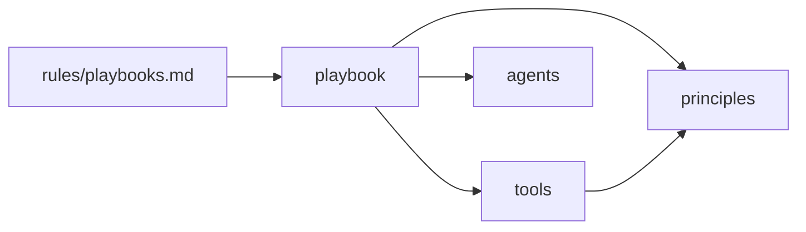

# karim-skills

My personal agent skills for Claude Code and Agent Skills-compatible harnesses.

Every task runs in one **playbook**: a short, numbered checklist for one situation. Each step ends in a *Done when* the agent must show evidence for, so a run can be inspected step by step. [`rules/playbooks.md`](rules/playbooks.md) is always loaded and makes the agent pick one.

| Folder | What lives there |
|---|---|
| [`skills/playbooks/`](skills/playbooks) | The 11 situations: investigation, discovery, planning, feature, bug-fix, refactoring, perf, prototype, review, shipping, authoring-a-skill |
| [`skills/tools/`](skills/tools) | Capabilities playbooks call (how, why, research, grilling, tdd, pr, ...) and a few user-only commands (explain, teach, handoff, retro) |
| [`skills/principles/`](skills/principles) | Rules of judgment the playbooks cite by name |
| [`agents/`](agents) | `explorer` (legwork), `implementer` (builds one unit), `reviewer` (judgment) |
| [`rules/`](rules) | Always-on instructions |

## Scripts

- `scripts/link-skills.sh` symlinks skills, agents, and rules into `~/.claude/` and `~/.agents/skills`.
- `scripts/check-skills.py` fails on unknown skill or agent names, broken links, playbook steps without *Done when*, and skills no playbook reaches. Run it after every skill change.
