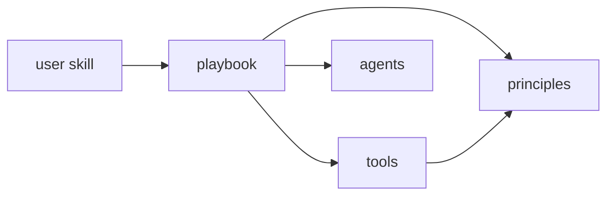

# karim-skills

My personal agent skills for Claude Code and Agent Skills-compatible harnesses.

Three tiers, each enforced by frontmatter and checked by `scripts/check-skills.py`:

| Tier | Folder | Who invokes it |
|---|---|---|
| User skills: the commands | [`skills/user/`](skills/user) | Only you: `/explore`, `/plan`, `/implement`, `/review`, `/ship`, `/grill-me`, `/explain`, `/handoff` |
| Playbooks: one mode per situation, with numbered steps that each end in *Done when* | [`skills/playbooks/`](skills/playbooks) | Only the agent, picked by a command |
| Principles: core behaviour | [`skills/principles/`](skills/principles) | Only the agent, cited by playbooks |

[`skills/tools/`](skills/tools) holds capabilities playbooks call (how, why, research, tickets, tdd, pr, ...), also agent-only. [`agents/`](agents) holds the only subagents, all on Haiku: `explorer` (reads), `implementer` (writes), `reviewer` (checks); the main session leads, with no orchestrator agent. [`rules/playbooks.md`](rules/playbooks.md) is always loaded: it maps free-form requests to a playbook and sets the delegation rules.

## Scripts

- `scripts/link-skills.sh` symlinks skills, agents, and rules into `~/.claude/` and `~/.agents/skills`.
- `scripts/check-skills.py` fails on unknown skill or agent names, broken links, playbook steps without *Done when*, skills in the wrong tier, and skills no user skill reaches. Run it after every skill change.
