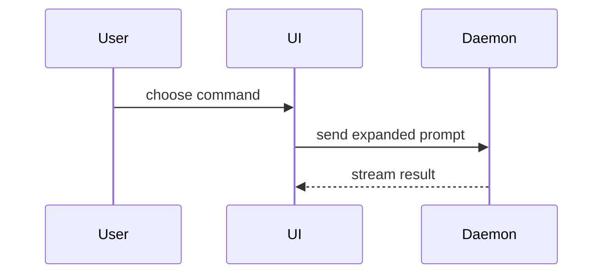

## Before you write

- **Read the tickets** this change finishes, with the fetch command in `docs/agents/issue-tracker.md`. Their `## Brief` acceptance criteria are what the evidence must prove; a bug's `## Diagnosis` names the command that went red.
- **Title** the PR as the change, in the repo's commit format under `### Commits` in `AGENTS.md` or `CLAUDE.md`. The ticket's title says the problem; the PR's says what was done.
- **Open it as a draft** with the first pushed commit, so the ticket shows work in progress, and mark it ready once the evidence is in. The commands are under **Pull requests** in `docs/agents/issue-tracker.md`.

Use this template for writing the PR body:

```markdown
Closes #<ticket>

## Summary

<diagram, diff-sketch, or tree>

## Evidence

<one entry per acceptance criterion>

- [x] <criterion>
  **Before:** <screenshot/output/failing test run>
  **After:** <screenshot/output/passing test run>
- [ ] <criterion> **Unproven:** <why>

## Merge Danger

**Door:** <one-way or two-way>

<optional: description>

**Blast Radius:** <one-word description>

<optional: potential ramifications of merge>
```

## Sections

Skip all preambles and keep prose brief. Use the user's domain language from `GLOSSARY.md`.

### Closes

One line per ticket this PR finishes: `Closes #12` (GitHub needs the keyword before each number; GitLab takes `Closes #12, #13`). The tracker closes them when the PR merges into the default branch. A ticket the PR only touches gets `Refs #12`. Never put `Closes` in a commit message.

### Summary

Pick the smallest view that makes the key point clear.

- Show logic or an algorithm as pseudocode:

```text
on(save)
  if content is unchanged
    return cached result
  write new content
  return fresh result
```

- Show runtime control flow as a call tree:

```text
submitForm
  createSession
    persistPrompt
    launchAgent
  navigateToSession
```

- Show UI structure as a component tree, including state and module boundaries that matter:

```text
<SessionPage> (apps/example/src/routes/session.tsx)
  useSessionEvents()
  <SessionToolbar>
    <RunSkillButton> (packages/ui)
```

- Show file responsibility or a broad refactor as a shallow file tree:

```text
src/
├── commands/       # parses user actions
├── sessions/       # owns session state
└── transport/      # sends API requests
```

- Show component interaction, control flow, or data flow with Mermaid:



- Use `diff` when the point is what changes and the surrounding shape already exists. Match the diff shape to the topic.

For a component change:

```diff
 <SessionPage>
   useSessionEvents()
   <SessionToolbar>
+    <RunSkillButton />
   <SessionTimeline>
+    <SkillResultCard />
```

For a file-layout change:

```diff
 src/
 ├── commands/
+│   └── show-me.ts       # expands the slash command
 ├── sessions/
-└── transport.ts
+└── transport/
+    ├── client.ts
+    └── stream.ts
```

For a call-tree or call-stack change:

```diff
 submitForm
   createSession
     persistPrompt
+    expandSkillMention
     launchAgent
-  navigateToSession
+  navigateToSession
+    subscribeToEvents
```

For a state or control-flow change:

```diff
 on(save)
-  write content
+  if content is unchanged
+    return cached result
+  write new content
+  invalidate cache
```

- Show the whole block when most of it is new, when omitted context would hide ownership or order, or when the user needs a copyable target shape:

```ts
function expandSkill(command: string): string {
  const skillName = command.slice(1);
  return `use the ${skillName} skill`;
}
```

#### Guidance

Place each visual next to the short text it supports. Keep only the calls, files, props, states, and boundaries needed to answer the user's current question or the options to resolve the current discussion point.

You may use one of these, you may use several, it is unlikely you will use all of them. Use your judgement and don't overwhelm the user.

### Evidence

Prove the change works on the real thing; don't describe it. Give one entry per acceptance criterion in the tickets' `## Brief`, each with a before and an after captured the same way.

| The change | Before | After |
|---|---|---|
| Visible (UI, page, report, chart) | Screenshot on the default branch | Screenshot of the same view, same size and data, on this branch |
| New, with nothing before it | Screenshot or output showing it's absent: the 404, the missing button, `unknown option` | It working, plus one edge case |
| Bug | The `## Diagnosis` command, red | The same command, green |
| Not visible (API, CLI, data, perf) | The exact command and its output | The same command and its output |

- **Screenshots are the first choice** for anything a person sees. Take them with Playwright: check out the default branch for "before", this branch for "after". Upload them as **Upload a screenshot** in `docs/agents/issue-tracker.md` says, and embed the link.
- Trim output to the lines that carry the signal. Redact secrets.
- "Tests pass", "should work" and a description of the code are not evidence.
- A criterion you couldn't prove stays in the list, unchecked, marked **Unproven** with the reason.

### Merge Danger

Describe whether it's a one-way or two-way door. You can walk back through two-way doors, but not one-way doors. A PR that is cheap to roll back is lower risk. Changes that involve destructive actions or hard-to-reverse decisions are one-way doors.

A one-way door needs a human reviewer's approval before merge; say so and don't auto-merge.

The blast radius is the potential impact or scope of the changes introduced by this PR. Consider all possibilities. Examples are layout shift, breakages for consumers, mobile responsiveness, etc.
