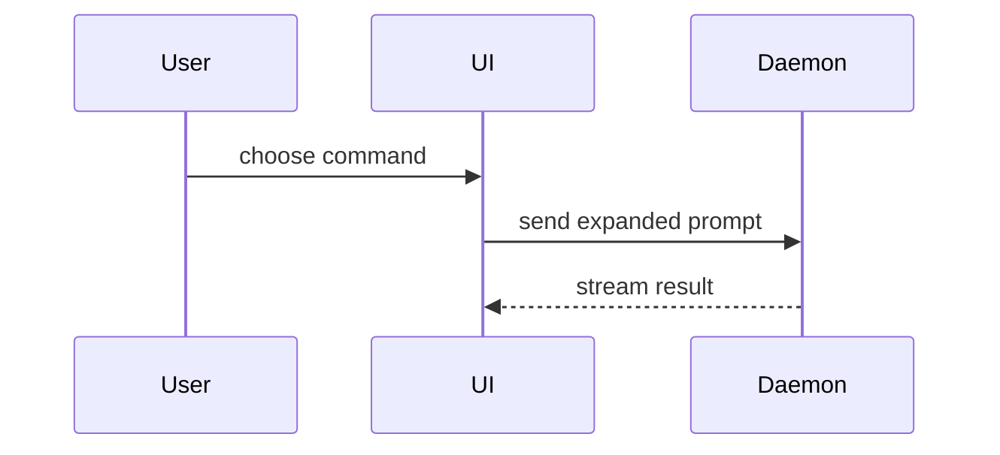

## Before you write

- **Read the tickets** this change finishes, with the fetch command in `docs/agents/issue-tracker.md`. Their `## Brief` acceptance criteria are what the evidence must prove; a bug's `## Diagnosis` names the command that went red.
- **Get the evidence** from the Demo that `review-code` ran: its folder, `.sandbox/demo-<short sha>/`, holds `demo.sh`, `before/` and `after/`. When `HEAD` has moved since, rerun `demo.sh` on `HEAD` into `.sandbox/demo-<new short sha>/after/`, keep the first `before/`, and look at every new screenshot and output before you use it. When no Demo ran, call the Skill tool with `review-code` first. A ticket PR inside an `implement-spec` run is the exception: that run's one Demo comes at the end, so the ticket PR shows its author's own run of the software.
- **Title** the PR as the change, in the repo's commit format under `### Commits` in `AGENTS.md` or `CLAUDE.md`. The ticket's title says the problem; the PR's says what was done.
- **Open it as a draft** with the first pushed commit, so the ticket shows work in progress, and mark it ready once the evidence is in. The commands are under **Pull requests** in `docs/agents/issue-tracker.md`.

Use this template for writing the PR body:

```markdown
Closes #<ticket>

## Summary

<diagram, diff-sketch, or tree>

## Evidence

`<short sha>` against `<fixed point's short sha>` · <offline or live> demo

<one entry per acceptance criterion>

**1. <criterion, as a person sees it>**
`<command that was run>`
~~~diff
- <output before>
+ <output after>
~~~

**2. <criterion a person sees on screen>**

| Before | After |
|---|---|
|  |  |

**3. <criterion>** Unproven: <why>

<details><summary>Rerun the demo</summary>

~~~sh
<demo.sh>
~~~

</details>

## Merge Danger

**Door:** <one-way or two-way>

<optional: description>

**Blast Radius:** <one-word description>

<optional: potential ramifications of merge>
```

## Sections

Skip all preambles and keep prose brief. Use the user's domain language from `GLOSSARY.md`.

### Closes

One line per ticket this PR finishes: `Closes #12` (GitHub needs the keyword before each number; GitLab takes `Closes #12, #13`). The tracker closes them when the PR merges into the default branch. A ticket the PR only touches gets `Refs #12`. Never put `Closes` in a commit message.

### Summary

Pick the smallest view that makes the key point clear.

- Show logic or an algorithm as pseudocode:

```text
on(save)
  if content is unchanged
    return cached result
  write new content
  return fresh result
```

- Show runtime control flow as a call tree:

```text
submitForm
  createSession
    persistPrompt
    launchAgent
  navigateToSession
```

- Show UI structure as a component tree, including state and module boundaries that matter:

```text
<SessionPage> (apps/example/src/routes/session.tsx)
  useSessionEvents()
  <SessionToolbar>
    <RunSkillButton> (packages/ui)
```

- Show file responsibility or a broad refactor as a shallow file tree:

```text
src/
├── commands/       # parses user actions
├── sessions/       # owns session state
└── transport/      # sends API requests
```

- Show component interaction, control flow, or data flow with Mermaid:



- Use `diff` when the point is what changes and the surrounding shape already exists. Match the diff shape to the topic.

For a component change:

```diff
 <SessionPage>
   useSessionEvents()
   <SessionToolbar>
+    <RunSkillButton />
   <SessionTimeline>
+    <SkillResultCard />
```

For a file-layout change:

```diff
 src/
 ├── commands/
+│   └── show-me.ts       # expands the slash command
 ├── sessions/
-└── transport.ts
+└── transport/
+    ├── client.ts
+    └── stream.ts
```

For a call-tree or call-stack change:

```diff
 submitForm
   createSession
     persistPrompt
+    expandSkillMention
     launchAgent
-  navigateToSession
+  navigateToSession
+    subscribeToEvents
```

For a state or control-flow change:

```diff
 on(save)
-  write content
+  if content is unchanged
+    return cached result
+  write new content
+  invalidate cache
```

- Show the whole block when most of it is new, when omitted context would hide ownership or order, or when the user needs a copyable target shape:

```ts
function expandSkill(command: string): string {
  const skillName = command.slice(1);
  return `use the ${skillName} skill`;
}
```

#### Guidance

Place each visual next to the short text it supports. Keep only the calls, files, props, states, and boundaries needed to answer the user's current question or the options to resolve the current discussion point.

You may use one of these, you may use several, it is unlikely you will use all of them. Use your judgement and don't overwhelm the user.

### Evidence

A person reads this section to see the change working: make the proof loud and the text short. Give one entry per acceptance criterion in the tickets' `## Brief`: the criterion in bold, as a person sees it, then the command that was run and one thing the Demo captured on the commit the PR points at. The first line names that commit, the commit it is compared against, and whether the demo ran offline or live.

- **Proof is a demo run**: the real command with its real output, or a screenshot. Tests stay out of the PR: a criterion only a test covers is **Unproven**.
- **Text output**: before and after in one `diff` block, as the script saved it, cut to the lines that prove the criterion (about eight, `…` marking each cut, secrets redacted). Something new shows only the after.
- **Anything on screen**: before and after screenshots side by side, uploaded as **Upload a screenshot** in `docs/agents/issue-tracker.md` says. Without a screenshot it is **Unproven**.
- **The entry is the proof**: at most one caption line under it. A criterion the Summary's diff already proves reads "shown in the Summary".
- **Unproven and Failed**: a criterion the Demo could not show stays in the list, marked **Unproven** with the reason. One the Demo saw fail blocks ready until it's fixed.
- **`demo.sh` alone** goes in the collapsed block, so a reviewer can rerun the demo.

### Merge Danger

Describe whether it's a one-way or two-way door. You can walk back through two-way doors, but not one-way doors. A PR that is cheap to roll back is lower risk. Changes that involve destructive actions or hard-to-reverse decisions are one-way doors.

Every merge waits for the user's approval; name a one-way door plainly, so that approval is given knowing it.

The blast radius is the potential impact or scope of the changes introduced by this PR. Consider all possibilities. Examples are layout shift, breakages for consumers, mobile responsiveness, etc.
